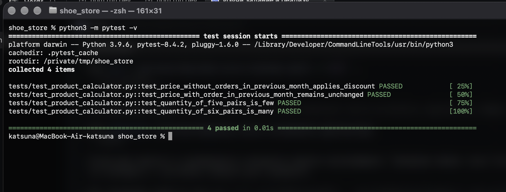

# Вариативная часть. Задание 6: тестирование программных модулей

Модуль `logic/product_calculator.py` взят из Приложения 4 без изменений. Модульные тесты находятся в папке `tests`.

## Протокол тестирования

Фреймворк модульного тестирования — pytest (Python).

Порядок запуска тестов:

1. Открыть папку `shoe_store` в терминале.
2. Выполнить команду `python -m pytest -v`. На Windows также можно использовать `py -m pytest -v`.

| № | Проверяемый случай | Входные данные | Ожидаемый результат | Фактический результат | Статус |
|---|---|---|---|---|---|
| 1 | Заказов в предыдущем месяце нет | Цена 2000; заказов нет; дата расчёта 15.06.2027 | 1500 | 1500 | Пройден |
| 2 | Есть заказ в предыдущем месяце | Цена 2000; заказ 10.05.2027; дата расчёта 15.06.2027 | 2000 | 2000 | Пройден |
| 3 | Граничное значение количества | Количество пар 5 | мало | мало | Пройден |
| 4 | Количество больше порогового | Количество пар 6 | много | много | Пройден |

Все четыре теста прошли. Результат запуска — `4 passed`.

